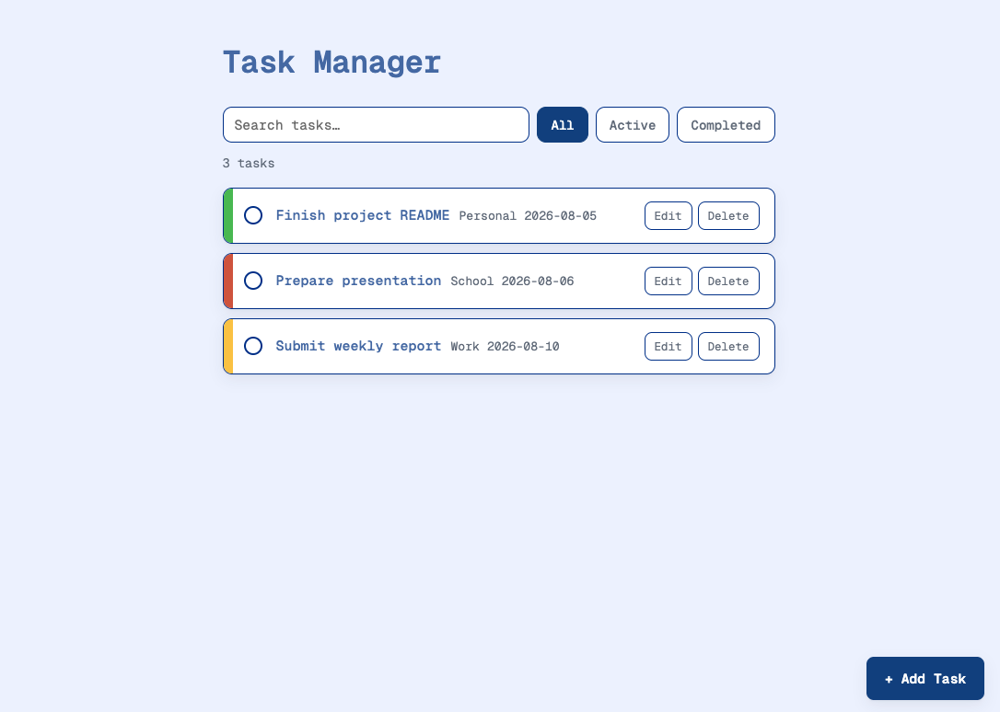

# Task Manager
A full-stack task management application for organizing and tracking tasks by status, priority, category, and due date. Built with React and Node.js, with persistent task storage using MongoDB.

## Live Demo
[View Live Demo](https://task-manager-2dld.onrender.com)

## Features
- Create, edit, and delete tasks
- Mark tasks as completed
- Filter tasks by active and completed status
- Search tasks by title
- Assign task categories and priorities
- Set and track due dates
- Persist task data using MongoDB
- Responsive task management interface



## Tech Stack

### Frontend 
- React
- Vite
- Axios

### Backend
- Node.js 
- Express

### Database
- MongoDB
- Mongoose

### Deployment
- Render

## Running Locally

### Prerequisites
Make sure you have Node.js and npm installed. You will also need access to a MongoDB database.

### 1. Clone the repository

```bash
git clone <repository-url> 
cd Task-Manager
```

### 2. Install frontend dependencies

```bash
npm install
```

### 3. Install backend dependencies

```bash
cd backend 
npm install
```

### 4. Configure environment variables

Create a .env file inside the backend directory and provide your MongoDB connection string:

```bash
MONGODB_URI=<your-mongodb-connection-string>
```

5. Build the frontend
From the project root:

```bash
npm run build
```

6. Start the backend
From the backend directory:

```bash
npm start
```

The application will be available at:

http://localhost:3001


## What I Learned 
I built this project to strengthen my understanding of how the different layers of a full-stack application work together. I started with a React frontend and progressively introduced a REST API, backend persistence, and deployment.

Through the project, I gained experience with:

- Designing RESTful CRUD endpoints with Express
- Connecting a React frontend to a Node.js backend using Axios
- Modeling and persisting application data with MongoDB and Mongoose
- Managing asynchronous frontend/backend communication
- Serving a production React build through an Express backend
- Configuring environment variables for local and deployed environments
- Deploying a full-stack application with persistent cloud-hosted data

## Technical Decisions

The frontend and backend are deployed together as a single application. Express serves the production React build while exposing task operations through `/api/tasks`.

MongoDB replaced the application's initial in-memory storage so tasks persist across sessions and server restarts. Mongoose is used to define the task model and interact with MongoDB.
